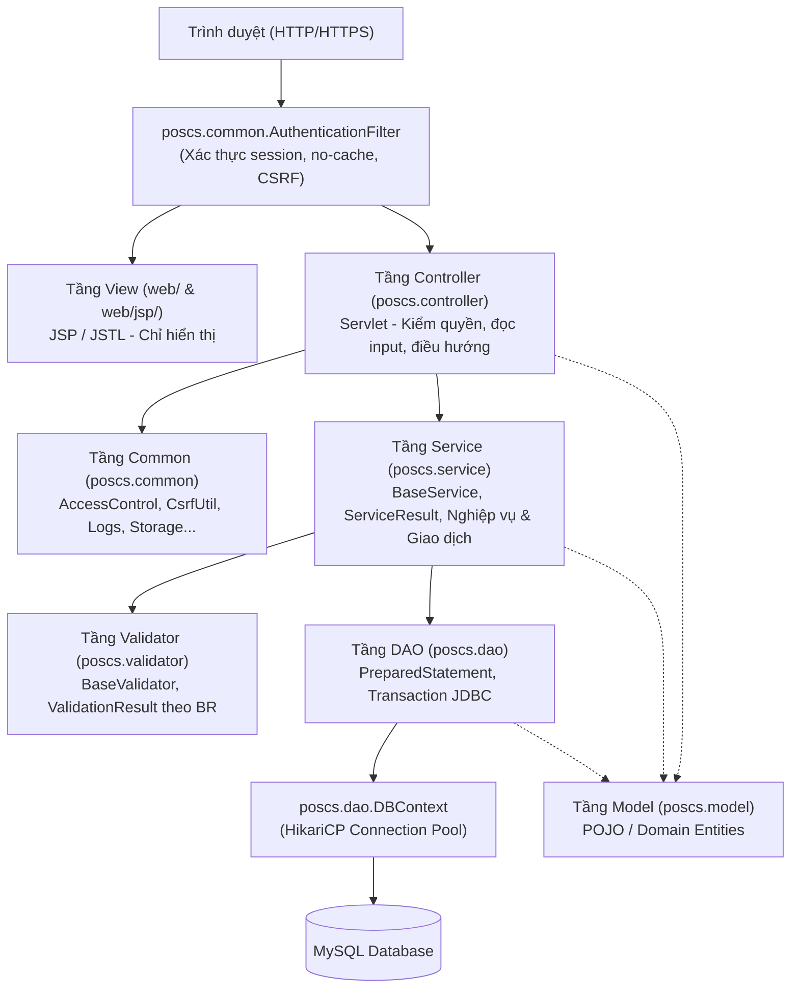
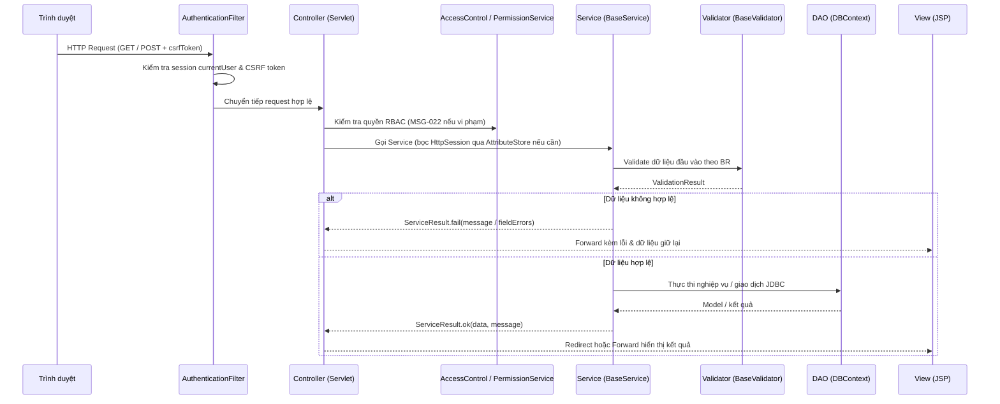
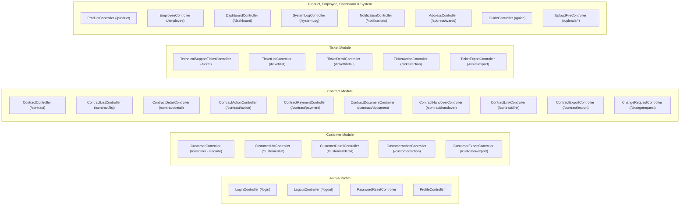
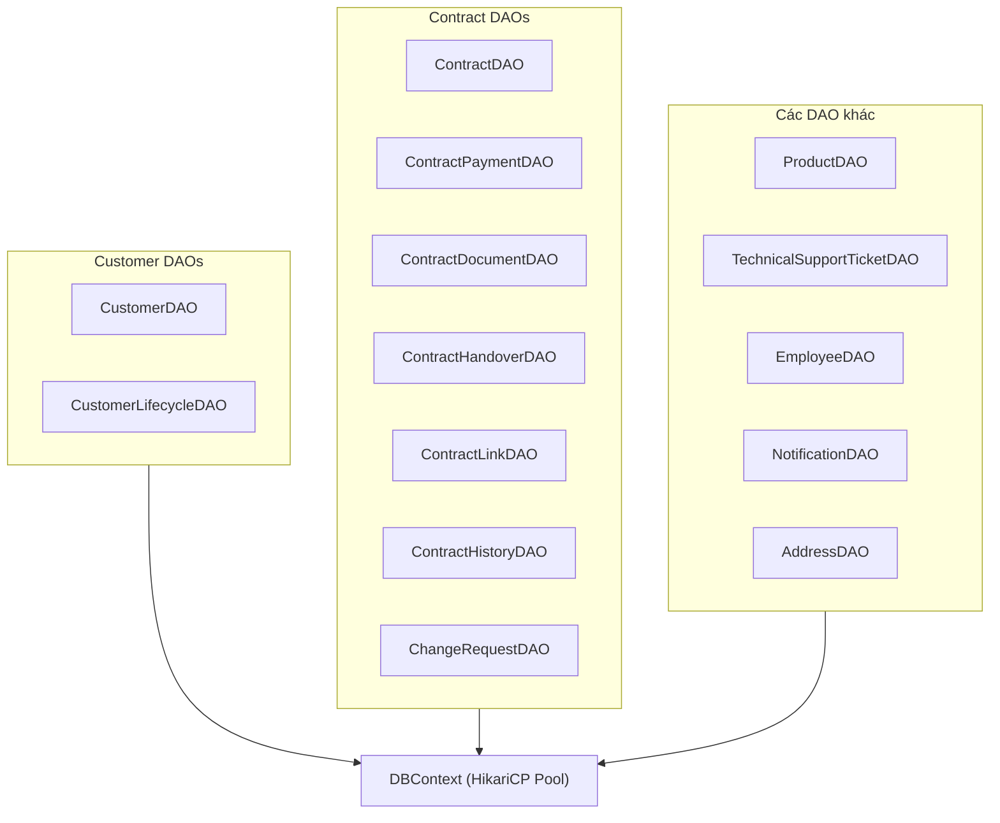

# Kiến trúc hệ thống POSCS

Tài liệu mô tả kiến trúc phân tầng và cấu trúc mã nguồn thực tế của hệ thống **POSCS** (nền tảng Java 21 / Jakarta EE 11, JSP/JSTL, MySQL, build bằng Apache Ant), tuân thủ quy chuẩn tại `.gemini/rules.md` (§4) và đối chiếu nghiệp vụ từ `docs/SPEC.md`.

---

## 1. Tổng quan kiến trúc phân tầng

Hệ thống tổ chức theo mô hình phân tầng (Layered Architecture), mỗi tầng đảm nhiệm một trách nhiệm tách biệt:

### Luồng xử lý một Request tiêu chuẩn

### Nguyên tắc trách nhiệm từng tầng (`.gemini/rules.md` §4)

| Gói / Thư mục | Vai trò & Ranh giới trách nhiệm |
|---|---|
| `view` (`web/`, `web/jsp/`) | Chỉ hiển thị giao diện bằng JSP/JSTL; **không chứa logic nghiệp vụ**. |
| `poscs.controller` | Kiểm tra quyền truy cập, nhận và phân tích tham số đầu vào, gọi `service`, chọn view/redirect; **không chứa logic nghiệp vụ**. |
| `poscs.service` | Chứa toàn bộ logic nghiệp vụ, điều phối giao dịch (transaction) và kiểm tra quyền chi tiết (`PermissionService`). Không phụ thuộc Servlet API. |
| `poscs.validator` | Kiểm tra tính hợp lệ của dữ liệu đầu vào theo các quy tắc nghiệp vụ (BR) trong `SPEC.md`. |
| `poscs.dao` | Truy cập CSDL MySQL qua `PreparedStatement` và `DBContext` (HikariCP); các thao tác ghi nhiều bảng chạy trong cùng một giao dịch. |
| `poscs.model` | Các lớp POJO biểu diễn thực thể nghiệp vụ và dữ liệu truyền giữa các tầng. |
| `poscs.common` | Bộ lọc bảo mật, phân quyền (`AccessControl`), CSRF, ghi log, lưu trữ file, tiện ích tiền tệ/thời gian/email/PDF/Excel và tác vụ nền. |

---

## 2. Chi tiết các tầng trong `src/java/poscs/`

### 2.1. Tầng Presentation (`poscs.controller` & `view`)

Tầng Controller gồm các Jakarta Servlet (`@WebServlet`) được tách theo từng module nghiệp vụ và theo nhóm tác vụ (List / Detail / Action / Export), kèm các lớp helper package-private để giữ kích thước file gọn nhẹ:

- **Auth & Profile**: `LoginController`, `LogoutController`, `PasswordResetController`, `ProfileController`.
- **Customer**: `CustomerController` đóng vai trò Front Controller / Facade ủy quyền cho `CustomerListController`, `CustomerDetailController`, `CustomerActionController`, `CustomerExportController` (hỗ trợ bởi `CustomerControllerHelper`).
- **Product**: `ProductController`.
- **Contract**: `ContractController`, `ContractListController`, `ContractDetailController`, `ContractActionController` (gồm tạo, sửa, phụ lục, ký & tiến độ, hủy, chữa sai sót UC-54, hàng hóa), cùng các controller chuyên biệt: `ContractPaymentController`, `ContractDocumentController`, `ContractHandoverController`, `ContractLinkController`, `ContractExportController`, `ChangeRequestController` (UC-50, UC-51) và các helper (`ContractControllerHelper`, `ContractFilterHelper`, `ContractActionResultHelper`, `ContractHandoverHelper`).
- **Ticket**: `TechnicalSupportTicketController` (Facade `/ticket`) cùng các controller tách riêng: `TicketListController`, `TicketDetailController`, `TicketActionController`, `TicketExportController` và `TicketActionHelper`.
- **Employee**: `EmployeeController`.
- **Dashboard, Log & Tiện ích hệ thống**: `DashboardController`, `SystemLogController`, `NotificationController`, `AddressController`, `GuideController`, `UploadFileController`.

---

### 2.2. Tầng Service (`poscs.service`)

Tầng Service kế thừa `BaseService` và giao tiếp với Controller thông qua **Result/Response pattern** (`ServiceResult<T>`), hoàn toàn độc lập với Servlet API:

- **`BaseService`**: Lớp cơ sở cung cấp `Logger` và các phương thức helper `success(...)`, `failure(...)`, `error(...)` trả về `ServiceResult<T>`.
- **`ServiceResult<T>`**: Wrapper bất biến chứa trạng thái `success`, dữ liệu `data`, thông điệp chung `message` và bản đồ lỗi theo từng trường `fieldErrors` (chuyển đổi trực tiếp từ `ValidationResult`).
- **`AttributeStore`**: Interface trừu tượng hóa kho thuộc tính kiểu session (`get`, `set`, `remove`), giúp `AuthService` hoặc các service cần lưu trạng thái phiên không phụ thuộc `HttpSession` (dễ kiểm thử đơn vị qua `AttributeStore.of(Map)`).
- **`PermissionService`**: Service trung tâm thực thi ma trận phân quyền RBAC 3 vai trò (`Admin`, `Sales`, `Kỹ thuật`), phân biệt cấp bậc quản lý vùng với nhân viên có cấp trên (`manager_id`), xác định phạm vi danh sách (`ListScope`) và chuẩn hóa thông báo vi phạm `MSG-022`.

**Các Service nghiệp vụ theo module:**

| Module | Lớp Service | Trách nhiệm chính |
|---|---|---|
| Auth & Profile | `AuthService`, `ProfileService` | Đăng nhập, khóa tạm, OTP quên mật khẩu, đổi mật khẩu/hồ sơ cá nhân. |
| Customer | `CustomerService`, `CustomerEvaluationService` | CRUD & xóa mềm khách hàng/NCC, danh sách/chi tiết, đánh giá xếp hạng quan hệ. |
| Product | `ProductService` | Quản lý sản phẩm, danh mục, ảnh và catalogue. |
| Contract | `ContractService`, `ContractPaymentService`, `ContractDocumentService`, `ContractHandoverService`, `ContractLinkService`, `ContractExportService` | Nghiệp vụ hợp đồng, phụ lục, chữa sai sót (UC-54), kỳ thanh toán, tài liệu đính kèm, bàn giao liên phòng, liên kết bán-mua, xuất dữ liệu. |
| Ticket | `TicketService`, `TicketExportService` | Tạo, cập nhật, phân công xử lý, xóa mềm phiếu hỗ trợ kỹ thuật và xuất dữ liệu. |
| Employee | `EmployeeService` | Quản lý tài khoản nhân viên, vai trò, phòng ban, cây cấp trên và phân vùng tỉnh. |
| Dashboard & Thông báo | `DashboardService` (kèm `DashboardSummary`), `NotificationService` | Tổng hợp số liệu dashboard theo vai trò/phạm vi và quản lý thông báo (hợp đồng sắp hết hạn 30 ngày, phiếu sắp quá hạn SLA 24 giờ). |

---

### 2.3. Tầng Validator (`poscs.validator`)

Tầng Validator tách riêng quy tắc kiểm tra đầu vào theo Business Rules (BR):

- **`BaseValidator`**: Lớp cơ sở cung cấp các hàm kiểm tra null-safe dùng chung: `required`, `minLength`, `maxLength`, `lengthBetween`, `matches`, `phoneVn` (BR-09), `email` (BR-10, tối đa 254 ký tự), `nonNegative`.
- **`ValidationResult`**: Lưu tập lỗi theo từng trường (`Map<String, String>` giữ thứ tự) và lỗi toàn cục (`GLOBAL_KEY = "_global"`), hỗ trợ `merge(...)`.

**Các Validator theo module:**
- `AuthValidator`
- `ProfileValidator`
- `CustomerValidator`
- `ProductValidator`
- `ContractValidator`
- `TicketValidator`
- `EmployeeValidator`

---

### 2.4. Tầng DAO (`poscs.dao`)

Tầng DAO chịu trách nhiệm tương tác trực tiếp với MySQL thông qua `DBContext` (sử dụng **HikariCP** connection pool, cấu hình qua system property hoặc biến môi trường `DB_URL`, `DB_USER`, `DB_PASSWORD`, đóng pool khi shutdown qua `DataSourceLifecycle`):

- **Customer**: `CustomerDAO` (DAO chính cho doanh nghiệp/người liên hệ/đánh giá), `CustomerLifecycleDAO` (dòng thời gian vòng đời khách hàng).
- **Contract**: `ContractDAO` (hợp đồng và hạng mục sản phẩm), phân tách các DAO con theo từng nghiệp vụ gắn với hợp đồng: `ContractPaymentDAO`, `ContractDocumentDAO`, `ContractHandoverDAO`, `ContractLinkDAO`, `ContractHistoryDAO`, `ChangeRequestDAO`.
- **Product**: `ProductDAO`.
- **Ticket**: `TechnicalSupportTicketDAO`.
- **Employee**: `EmployeeDAO`.
- **Notification & Address**: `NotificationDAO`, `AddressDAO`.

---

### 2.5. Tầng Model (`poscs.model`) & Common (`poscs.common`)

- **`poscs.model`** (27 POJO): `User`, `Role`, `Department`, `Province`, `District`, `Address`, `ProvinceAssignment`, `Enterprise`, `EnterpriseContact`, `RelationshipRating`, `CustomerEvaluationRule`, `CustomerLifecycleEvent`, `Product`, `ProductCategory`, `ProductImage`, `ProductCatalogue`, `Contract`, `ContractProduct`, `ContractPayment`, `ContractDocument`, `ContractHandover`, `ContractLink`, `ContractHistory`, `ChangeRequest`, `TechnicalRequest`, `TechnicalRequestHistory`, `Notification`.
- **`poscs.common`** (18 lớp hạ tầng & tiện ích):
  - **Bảo mật & Phân quyền**: `AuthenticationFilter`, `AccessControl`, `CsrfUtil`, `ClientIp`.
  - **Vòng đời & Tác vụ nền**: `DataSourceLifecycle`, `NotificationScheduler`.
  - **Dữ liệu, Định dạng & Truy vấn**: `ListScope`, `Period`, `MoneyVnd`, `TextRules`, `QueryStrings`, `SqlFilters`.
  - **Tài liệu, Lưu trữ, Email & Log**: `ExcelUtil`, `PdfUtil`, `FileStorage`, `EmailUtil`, `Logs`, `LogFiles`.

---

## 3. Các quy ước an toàn & bảo mật xuyên suốt

1. **Xác thực & Chống CSRF**: `AuthenticationFilter` chặn toàn bộ request chưa đăng nhập (trừ allow-list trong `PUBLIC_PATHS`), gắn header `no-cache` và kiểm tra `csrfToken` cho mọi request `POST` qua `CsrfUtil`.
2. **Phân quyền hai lớp (RBAC + Cây tổ chức)**: Thực thi phía server qua `AccessControl` và `PermissionService` với 3 vai trò (`Admin`, `Sales`, `Kỹ thuật`); phân biệt Sales quản lý vùng (`manager_id == null`, có quyền ghi) với Sales cấp dưới (chỉ xem và gửi yêu cầu thay đổi).
3. **Xóa mềm**: Dữ liệu cốt lõi (khách hàng, sản phẩm, hợp đồng, phiếu, tài liệu hợp đồng) áp dụng cờ `is_deleted` thay vì xóa vật lý.
4. **Truy vấn an toàn**: 100% truy vấn dùng `PreparedStatement`; mật khẩu băm bằng BCrypt.
